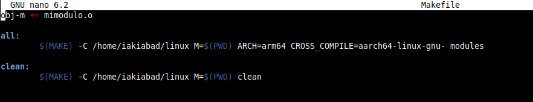
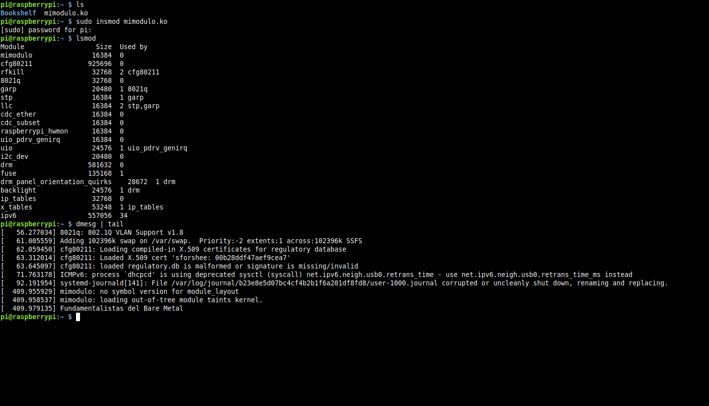
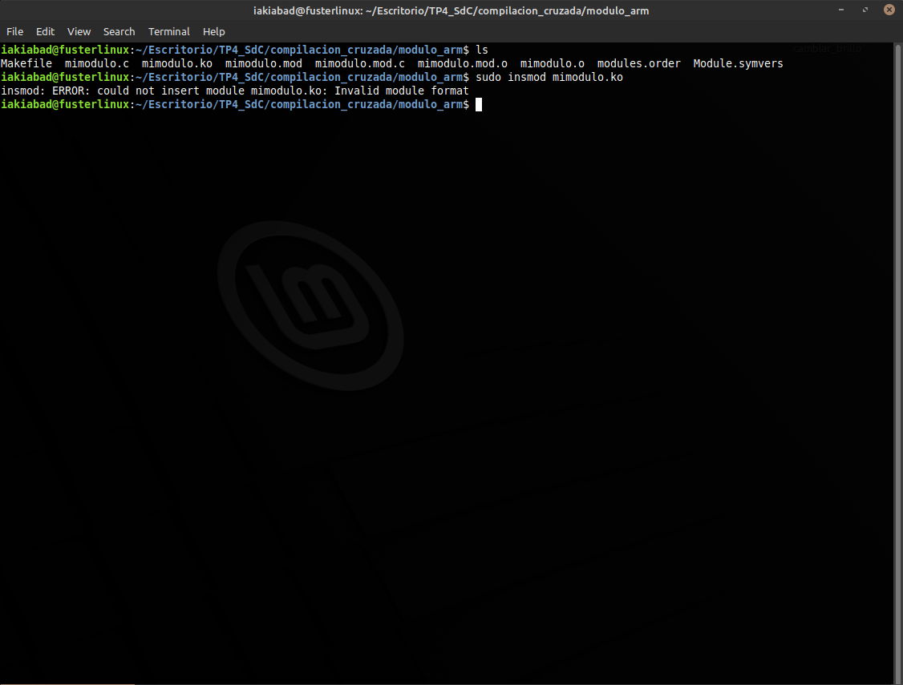
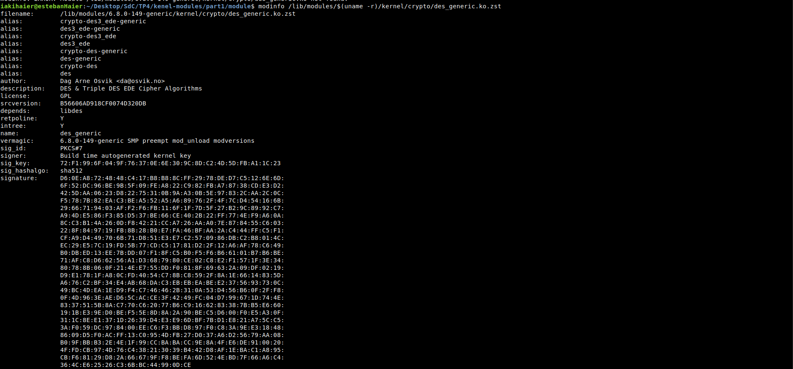
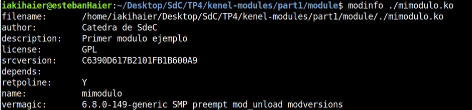
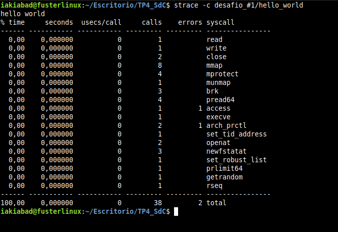

# SISTEMAS DE COMPUTACIÓN

## TP4: Módulos de kernel y llamadas a sistema

**Integrantes:**
Abad, Iñaki
Mensi Spachessi, Valentín

**Docente:** Javier JORGE

---

**Índice**

- [Descripción del trabajo](#descripción-del-trabajo)
- [Compilación cruzada](#compilación-cruzada)
- [Desafío #1](#desafío-1)
- [Desafío #2 — Conceptos fundamentales](#desafío-2--conceptos-fundamentales)
- [Actividades prácticas obligatorias](#actividades-prácticas-obligatorias)
- [Bibliografía y referencias](#bibliografía-y-referencias)

---

## Descripción del trabajo

Trabajamos con un módulo de kernel que obtuvimos del repositorio:

<https://gitlab.com/sistemas-de-computacion-unc/kenel-modules.git>

Lo editamos para que al cargarlo, muestre el nombre de nuestro grupo en los registros del kernel. Lo compilamos para x86 y lo cross-compilamos para arm64. Luego lo cargamos en una raspberry pi emulada en qemu. Además, completamos los desafíos #1 y #2 propuestos en la consigna, junto a las actividades prácticas.

Todos los códigos, archivos e imágenes utilizados se encuentran en el repositorio de GitHub: <https://github.com/iakiabad/TP4_SdC>

---

## Compilación cruzada

Como mencionamos antes, en esta sección del TP nos dedicamos a compilar nuestro módulo de kernel para arm64 desde nuestra computadora con un procesador x86. Para ello, debimos primero emular una raspberry pi utilizando qemu. Utilizamos este instructivo para hacerlo: [Emulating a Raspberry Pi in QEMU | Interrupt](https://interrupt.memfault.com/blog/emulating-raspberry-pi-in-qemu).

Para llevar a cabo la compilación cruzada, es necesario contar con los headers y archivos de configuración del kernel en el que se va a cargar el módulo (“To build external modules, you must have a prebuilt kernel available that contains the configuration and header files used in the build.” [Building External Modules — The Linux Kernel documentation](https://docs.kernel.org/6.1/kbuild/modules.html)).

Para obtener los headers files había que conseguir el código fuente del kernel de la raspberrypi. Ejecutamos el comando `uname -r` en la raspberry emulada para obtener la versión exacta del kernel (6.1.21). Investigando en internet, encontramos un foro ([Kernel source of Raspberry PI OS](https://forums.raspberrypi.com/viewtopic.php?t=359468)) en el que un usuario informaba el commit y la rama exacta en la que se encontraba el código fuente de esa versión del kernel. Para obtenerlo ejecutamos: `git clone --depth=1 --branch 1.20230405 https://github.com/raspberrypi/linux`.

El archivo .config lo obtuvimos del dispositivo emulado, utilizando el protocolo SSH y el comando scp para transferirlo al sistema de archivos de la PC:

```bash
scp -P 2222 pi@localhost:/home/pi/config.gz /home
```

Luego, copiamos el archivo .config a la raíz del repositorio que contiene el código fuente del kernel de la raspberrypi:

```bash
cp /home/config /home/iakiabad/linux/.config
```

Paral llevar a cabo la compilación propiamente dicha, primero instalamos los paquetes necesarios, especificados en la documentación oficial de raspberrypi, para cross-compilar (<https://www.raspberrypi.com/documentation/computers/linux_kernel.html#building>):

```bash
sudo apt install bc bison flex libssl-dev make libc6-dev libncurses5-dev
```

Luego creamos el Makefile:



*Figura 1 — Makefile del módulo para arm64, abierto en nano. Apunta al árbol del kernel de la raspberry (`/home/iakiabad/linux`) y define `ARCH=arm64` y `CROSS_COMPILE=aarch64-linux-gnu-`.*

Antes de ejecutar make all, de acuerdo a [Building External Modules — The Linux Kernel documentation](https://docs.kernel.org/6.1/kbuild/modules.html), fue necesario ejecutar la siguiente línea, para evitar tener que compilar el kernel entero:

```bash
make ARCH=arm64 CROSS_COMPILE=aarch64-linux-gnu- modules_prepare
```

Este comando prepara el árbol de código fuente del kernel para la compilación de módulos externos, utilizando el archivo .config y generando los archivos adicionales necesarios, sin tener que compilar el kernel entero.

Solo entonces ejecutamos make all y utilizamos nuevamente el comando scp para transferir el módulo cargable .ko a la raspberry.

Finalmente, cargamos con éxito el módulo en la raspberry



*Figura 2 — Carga del módulo en la raspberry con `insmod`: aparece en `lsmod` y `dmesg` muestra el mensaje "Fundamentalistas del Bare Metal".*

Adicionalmente, intentamos cargar el módulo en la pc, pero como éste fue compilado para arm64 y no para x86 la carga falló



*Figura 3 — `insmod` del módulo compilado para arm64 en la PC x86: falla con `Invalid module format`.*

---

## Desafío #1

**1. ¿Qué es checkinstall y para qué sirve?**

Es una herramienta que intercepta la instalación de software compilado desde fuente y genera automáticamente un paquete nativo (`.deb`, `.rpm` o `.tgz`). Permite instalar y desinstalar de forma limpia software compilado localmente.

Utilizamos `checkinstall` para empaquetar un *hello world* escrito en C y compilado con gcc:


*Figura 4 — Creación del archivo `hello_world.c`, compilación con `gcc` y ejecución del binario.*

Luego, para empaquetar, usamos el siguiente comando:

```bash
sudo checkinstall install -D hello_world /usr/local/bin/hello_world
```

Esta fue la salida en consola:


*Figura 5 — Salida de `checkinstall`: se genera e instala el paquete `desafio--1_20261119-1_amd64.deb`.*

**2. Investigar cómo mejorar la seguridad del kernel:**

Para mejorar la seguridad del kernel es fundamental restringir la ejecución de código no confiable en modo privilegiado (anillo 0) y endurecer la protección de la memoria. Esto se logra exigiendo la firma criptográfica de los módulos mediante Secure Boot y `module.sig_enforce=1`, bloqueando la carga dinámica tras el arranque (`kernel.modules_disabled=1`), y aplicando mitigaciones contra rootkits como KASLR, SMEP/SMAP y páginas de memoria de solo lectura (`CONFIG_STRICT_KERNEL_RWX`).

Finalmente, se complementa con herramientas de auditoría e integridad como mokutil, rkhunter y AIDE.

---

## Desafío #2 — Conceptos fundamentales

**1. ¿Qué funciones tiene disponible un programa de usuario y cuáles tiene un módulo del kernel?**

Un programa de usuario tiene acceso a librerías como la estándar de C y a librerías de terceros, pero al ejecutarse sin privilegios directos sobre el hardware debe invocar llamadas al sistema para solicitar recursos al sistema operativo. En cambio, un módulo del kernel no puede usar bibliotecas de espacio de usuario. Únicamente dispone de la API interna exportada por el propio kernel (`EXPORT_SYMBOL`), contando con funciones como `printk()`, que utilizamos en este trabajo.

**2. Describir espacio de usuario, espacio de kernel y espacio de datos.**

El espacio de usuario (user space) es la región de memoria virtual donde corren las aplicaciones y servicios comunes en anillo 3 de privilegio, manteniendo cada proceso su propio mapa de direcciones aislado para que un fallo no comprometa al resto del sistema. Por el contrario, el espacio de kernel es la zona privilegiada en anillo 0 donde reside y se ejecuta el núcleo del sistema operativo junto a sus módulos, con acceso total a la memoria física y al hardware. Finalmente, el espacio de datos hace referencia a la memoria destinada a alojar las variables y estructuras de cada entorno.

**3. Investigar el contenido de /dev y el rol de los drivers.**

El directorio `/dev` contiene archivos especiales que representan dispositivos físicos o virtuales del sistema, permitiendo que las aplicaciones interactúen con ellos desde el espacio de usuario. Estos archivos pueden ser de caracteres o de bloques y se identifican mediante números mayores (major) y menores (minor).

Los drivers son componentes del kernel encargados de controlar los dispositivos, gestionar las operaciones de lectura y escritura y traducir las solicitudes de las aplicaciones en acciones sobre el hardware.

De esta manera, `/dev` proporciona una interfaz de acceso a los dispositivos y los drivers implementan su funcionamiento.

---

## Actividades prácticas obligatorias

**1. Comparar modinfo de tu módulo con el de un módulo del sistema (ej. des_generic.ko). ¿Qué diferencias se observan?**



*Figura 6 — `modinfo` de `des_generic.ko.zst`, módulo del sistema (kernel `6.8.0-149-generic`).*



*Figura 7 — `modinfo` de `mimodulo.ko`, nuestro módulo.*

Se observa que el modinfo de nuestro módulo carece de varios campos, en comparacion con el de des_generic.ko. Esto se debe principalmente a que nuestro módulo no está firmado y no tiene alias asignados.

**2. Listar los módulos cargados en las PCs de todos los integrantes del grupo. Subir las salidas al repositorio y hacer un `diff` en el informe. Explicar las diferencias.**

**3. ¿Cuáles módulos están disponibles pero no cargados? ¿Qué ocurre cuando el driver de un dispositivo no está disponible?**

Los módulos que están disponibles pero no cargados son los módulos cuyos archivos .ko están instalados en `/lib/modules/$(uname -r)`, pero no aparecen en la lista de `lsmod`. Las salidas de ambos comandos se encuentran en el repositorio. Observamos que hay muchos más módulos disponibles que cargados. Los módulos disponibles pero no cargados permiten que Linux incorpore drivers y funcionalidades únicamente cuando los necesita, sin tener que mantenerlos todos cargados permanentemente.

Ejecutamos en nuestras PCs:

```bash
sudo -E hw-probe -all -upload -check -decode-acpi
```

Resultados:

Iñaki:
Probe URL: <https://linux-hardware.org/?probe=7301caf364>

Valen:

**4. Diferencia entre un módulo y un programa.**

Un programa es una aplicación que se ejecuta en espacio de usuario como un proceso independiente y realiza tareas específicas sin formar parte del núcleo del sistema operativo. En cambio, un módulo del kernel, es un componente de código que se incorpora al núcleo de Linux para extender sus funcionalidades, por ejemplo, agregar un driver para controlar un dispositivo. La principal diferencia es que los programas se ejecutan fuera del kernel, mientras que los módulos forman parte de él y tienen acceso a sus recursos internos.

**5. ¿Cómo ver las llamadas al sistema que realiza un hello world en C? (strace)**



*Figura 8 — Salida de `strace -c` sobre el ejecutable `hello_world`: resumen de las llamadas al sistema realizadas.*

En la imagen se pueden ver las llamadas realizadas al sistema al ejecutarse el hello world (el mismo que se usó en el desafío anterior), 38 en total.

**6. ¿Qué es un *segmentation fault*? ¿Cómo lo maneja el kernel y cómo lo hace un programa de usuario?**

Un segmentation fault es un error que ocurre cuando un proceso intenta acceder a una región de memoria a la que no tiene permitido acceder, por ejemplo, al desreferenciar un puntero inválido o escribir en una región de solo lectura.

El kernel detecta estas violaciones mediante excepciones de hardware relacionadas con la memoria virtual y, si no pueden resolverse, envía una señal SIGSEGV al proceso afectado. En un programa de usuario, esta señal puede ser manejada mediante un signal handler o, si no se maneja, provoca la terminación del proceso y, eventualmente, la generación de un archivo core dump. En cambio, si el acceso inválido ocurre dentro de código del kernel, no se trata como un error aislado de un proceso: puede provocar un kernel oops y, en casos graves, un kernel panic, comprometiendo la estabilidad del sistema.

**7. Agregar evidencia de compilación, carga y descarga de un módulo propio que imprima el nombre del equipo en los registros del kernel (`printk`).**


*Figura 9 — Compilación (`make all`) y carga (`insmod`) del módulo. En el final de `dmesg` se ven la descarga previa ("Modulo descargado del kernel.") y el mensaje de la nueva carga ("Fundamentalistas del Bare Metal").*


*Figura 10 — Descarga del módulo con `rmmod`: `dmesg` muestra al final "Modulo descargado del kernel.".*

**8. ¿Qué pasa si un compañero con Secure Boot habilitado intenta cargar un módulo firmado por vos?**

El kernel verifica la firma digital del módulo antes de permitir su carga. Sin embargo, no alcanza con que el módulo esté firmado: la clave pública que utilice debe ser reconocida como confiable por el sistema. Si la clave con la que firmé el módulo no está registrada entre las claves confiables del kernel, la carga será rechazada. Para permitirla, mi compañero tendría que incorporar mi clave pública al sistema de confianza

**9. A partir del artículo de Ars Technica (2024) sobre el parche de Microsoft y GRUB:**

Una actualización de seguridad de Microsoft, publicada en agosto de 2024, modificó las políticas SBAT para revocar componentes vulnerables de GRUB. Debido a un error en la detección de sistemas con arranque dual, algunos equipos aplicaron la actualización y dejaron de poder iniciar Linux con Secure Boot habilitado. Windows seguía funcionando normalmente.

Desactivar el Secure Boot permitió volver a iniciar Linux, pero se perdió la protección que ofrece frente a la ejecución de componentes de arranque no confiables. Esto aumenta la exposición a bootkits y otras modificaciones maliciosas del proceso de inicio.

El proposito general de Secure Boot es garantizar que durante el proceso de arranque solamente se ejecuten componentes de software cuya firma digital sea válida y esté respaldada por una clave de confianza. De esta manera, busca impedir que código malicioso o no autorizado se ejecute antes de que el sistema operativo tome el control.

---

## Bibliografía y referencias

- [The Linux Kernel Module Programming Guide](https://sysprog21.github.io/lkmpg/#what-is-a-kernel-module)
- [Red Hat — Signing kernel modules for Secure Boot](https://access.redhat.com/documentation/es-es/red_hat_enterprise_linux/8/html/managing_monitoring_and_updating_the_kernel/signing-kernel-modules-for-secure-boot_managing-kernel-modules)
- [strace — OpenSource.com](https://opensource.com/article/19/10/strace)
- [Presentación de la cátedra](https://docs.google.com/presentation/d/1BYES6Zkfx5K85REWyXsFeW-VngBLOzlDzaYCsTVoc0Y/edit#slide=id.g724a4c87a0_0_5)
- [Cómo firmar módulos de kernel](https://askubuntu.com/questions/770205/how-to-sign-kernel-modules-with-sign-file)
- [Artículo Ars Technica sobre el parche de Microsoft y GRUB](https://arstechnica.com/security/2024/08/a-patch-microsoft-spent-2-years-preparing-is-making-a-mess-for-some-linux-users/)
- [linux-hardware.org](https://linux-hardware.org/)
- [The Linux kernel - Raspberry Pi Documentation](https://www.raspberrypi.com/documentation/computers/linux_kernel.html#building)
- [Building External Modules — The Linux Kernel documentation](https://docs.kernel.org/6.1/kbuild/modules.html)
- <https://github.com/raspberrypi/linux>.
